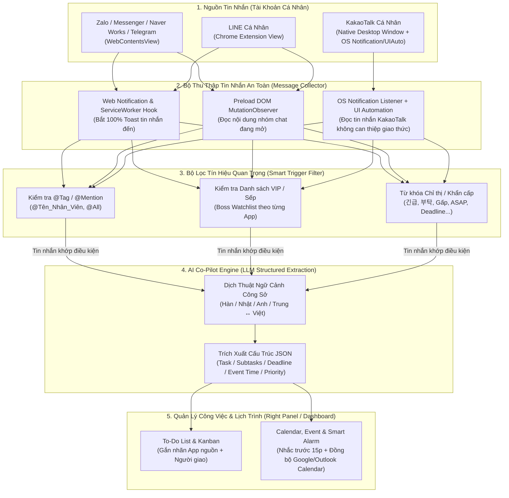

# Thiết Kế Phân Hệ AI Trợ Lý Công Việc: Tự Động Dịch, Bắt Chỉ Thị Sếp, Tạo To-Do & Lịch Trình (`AI Work Assistant`)

Tài liệu này mô tả chi tiết kiến trúc của phân hệ **AI Work Co-Pilot** bên trong **MultiWork** — giúp nhân viên theo dõi các nhóm chat cá nhân trên **KakaoTalk, LINE, Naver Works, Zalo, Messenger, Telegram**, tự động phát hiện khi **Sếp (Quản lý) `@tag` hoặc giao việc**, tự động **dịch đa ngôn ngữ** và chuyển thành **To-Do List / Event / Schedule**.

---

## 1. Bài toán Thực tế (User Story)

1. Nhân viên làm việc với khách hàng và sếp từ nhiều quốc gia (Hàn Quốc qua **KakaoTalk / Naver Works**, Nhật Bản/Đài Loan qua **LINE**, Việt Nam/Quốc tế qua **Zalo / Telegram / Messenger**) bằng **tài khoản cá nhân**.
2. Trong hàng chục nhóm chat trôi liên tục:
   - Khi **Sếp `@tag` tên nhân viên** hoặc nhắn tin chỉ đạo (bằng tiếng Hàn, Nhật, Anh, Trung, Việt...), nhân viên rất dễ bị trôi tin nhắn hoặc hiểu sai ý nếu dịch thủ công.
3. **Yêu cầu tự động hóa của MultiWork**:
   - Tự động bắt được tin nhắn khi có `@mention` hoặc từ danh sách **VIP/Sếp** đã cấu hình.
   - **Tự động dịch** sang ngôn ngữ của người dùng (VD: Tiếng Hàn/Nhật/Anh $\rightarrow$ Tiếng Việt) kèm bản gốc để đối chiếu.
   - **Phân tích ý định (Intent Detection)**: Nhận diện đây là **Chỉ thị giao việc (Task)** hay **Lịch họp / Sự kiện (Event/Schedule)**.
   - **Tự động thêm vào To-Do List** và **đặt Lịch hẹn / Nhắc việc (Calendar & Reminder)** ngay trong MultiWork (kèm nút "Nhảy tới nhóm chat gốc").

---

## 2. Sơ đồ Luồng Xử Lý Tự Động (End-to-End AI Pipeline)



---

## 3. Cơ chế Bắt Tin Nhắn An Toàn Cho Tài Khoản Cá Nhân (Zero Ban Risk)

Vì tất cả đều là **tài khoản cá nhân**, nguyên tắc sống còn là **TUYỆT ĐỐI KHÔNG dùng API lậu / Unofficial Protocol** (như thư viện LOCO lậu cho KakaoTalk hay Zalo API lậu) vì sẽ bị khóa tài khoản. MultiWork đọc dữ liệu ở **tầng Hiển thị & Thông báo (Presentation & Notification Layer)**:

### 3.1. Đối với Zalo, Messenger, Naver Works, Telegram và LINE Extension
1. **Chặn bắt ở tầng `window.Notification` & `ServiceWorker` (Hoạt động cả khi không mở tab đó)**:
   - Khi có bất kỳ tin nhắn mới nào trong nhóm, bản thân ứng dụng Web/Extension sẽ tạo thông báo.
   - Preload Script của MultiWork bọc (wrap) hàm `window.Notification` để thu thập ngay lập tức:
     - `appType`: Zalo / Messenger / Naver Works / Telegram / LINE
     - `groupOrSenderName`: Tên nhóm chat hoặc tên Sếp
     - `rawMessage`: Nội dung tin nhắn (bao gồm cả `@Tên_bạn`)
     - `timestamp`: Thời gian nhận
2. **Đọc sâu bằng `MutationObserver` trên DOM (Khi đang mở cuộc trò chuyện)**:
   - Đọc trọn vẹn đoạn hội thoại nhiều câu liên tiếp của Sếp (vì sếp thường nhắn 2–3 câu liên tiếp để giao 1 việc), bao gồm cả nội dung tin nhắn được Reply/Quote.

### 3.2. Đối với KakaoTalk Cá Nhân (Windows & macOS)
Vì KakaoTalk chạy qua ứng dụng Desktop chính chủ được nhúng vào MultiWork:
1. **Trên Windows**:
   - **Cơ chế 1 (Windows Toast Notification Listener)**: Lắng nghe `UserNotificationChanged` của Windows để bắt tức thì mọi thông báo tin nhắn đến từ `KakaoTalk.exe` (gồm tên người gửi, tên phòng chat, nội dung tin nhắn).
   - **Cơ chế 2 (Windows UI Automation / Local OCR trên vùng cửa sổ nhúng)**: Đọc trực tiếp văn bản trong khung chat KakaoTalk đang hiển thị bên trong MultiWork.
2. **Trên macOS**:
   - Sử dụng **macOS Accessibility API (`AXUIElement`)** hoặc đọc từ Notification Center / vùng cửa sổ KakaoTalk để lấy nội dung tin nhắn mới một cách hợp lệ ở cấp hệ điều hành.

---

## 4. Thiết kế AI Pipeline: Dịch Thuật + Tạo To-Do + Đặt Lịch (Schedule)

### 4.1. Cấu hình "Nhận diện Sếp & Tag" (`Boss & Mention Rules`)
Người dùng có thể cài đặt trong MultiWork:
- **Tên định danh của tôi (My Mentions)**: `["@Son", "@Sơn", "박차장님", "Sơn ơi", "@all"]`.
- **Danh sách Sếp / VIP (Boss Watchlist)**:
  - VD: `Kim Director (KakaoTalk)`, `Park Manager (Naver Works)`, `Tanaka-san (LINE)`, `Giám đốc Hùng (Zalo)`.
- **Chế độ kích hoạt**:
  - *Chế độ 1 (Tự động hoàn toàn)*: Cứ tin nhắn từ Sếp hoặc có `@tag` tôi $\rightarrow$ Tự động dịch + Nếu phát hiện có giao việc/lịch hẹn thì tự đẩy vào To-Do List / Calendar (trạng thái `Suggested` hoặc `Auto-Added`).
  - *Chế độ 2 (Bán tự động)*: Hiển thị nút nổi (Floating AI Action) hoặc bôi đen tin nhắn bấm `Ctrl/Cmd + Shift + A` để dịch và tạo Task/Event ngay lập tức.

### 4.2. Cấu trúc Dữ liệu Đầu ra của AI (LLM JSON Schema)

Khi một tin nhắn (hoặc cụm tin nhắn liên tiếp) đi qua AI Engine (hỗ trợ **Gemini 2.5 Flash/Pro**, **OpenAI GPT-4o**, hoặc **Claude**), AI sẽ trả về cấu trúc chuẩn:

```json
{
  "source": {
    "platform": "kakaotalk",
    "accountId": "acc_kakao_1",
    "chatRoomName": "개발팀 프로젝트 (Nhóm Dự Án Dev)",
    "senderName": "김부장님 (Trưởng phòng Kim)",
    "isBoss": true,
    "isMentioned": true,
    "receivedAt": "2026-10-17T08:30:00+07:00"
  },
  "translation": {
    "detectedLanguage": "ko",
    "originalText": "@손님 오늘 오후 4시까지 주간 보고서 정리해서 보내주시고, 내일 오전 10시에 화상회의 잡으세요.",
    "translatedText": "@Sơn Chiều nay trước 4 giờ hãy tổng hợp báo cáo tuần gửi cho tôi, và đặt lịch họp video vào 10 giờ sáng mai nhé.",
    "toneAndContextNote": "Chỉ thị trực tiếp từ cấp trên, có 2 đầu việc rõ ràng kèm mốc thời gian."
  },
  "extractedTodos": [
    {
      "title": "Tổng hợp và gửi báo cáo tuần cho Trưởng phòng Kim",
      "description": "Hoàn thành báo cáo tuần theo yêu cầu trong nhóm Dự Án Dev",
      "priority": "HIGH",
      "dueAt": "2026-10-17T16:00:00+07:00"
    }
  ],
  "extractedEvents": [
    {
      "title": "Họp video (화상회의) với Trưởng phòng Kim",
      "startTime": "2026-10-18T10:00:00+07:00",
      "endTime": "2026-10-18T11:00:00+07:00",
      "reminderMinutesBefore": 15,
      "participants": ["Trưởng phòng Kim", "Sơn"]
    }
  ]
}
```

---

## 5. Giao diện Bảng Điều Khiển Trợ Lý (Right-Hand Assistant Drawer)

Cửa sổ MultiWork được chia làm **3 cột linh hoạt**:
1. **Cột Trái (Sidebar - 68px)**: Danh sách các icon ứng dụng & tài khoản (Zalo, KakaoTalk, LINE, Naver Works, Messenger, Telegram...).
2. **Cột Giữa (Main Chat Viewport - Linh hoạt)**: Hiển thị ứng dụng chat đang chọn.
3. **Cột Phải (AI Assistant & Schedule Panel - 340px, có thể đóng/mở bằng `Ctrl/Cmd + B`)**:
   - **Tab 1 — 🔔 Luồng Chỉ Thị & Dịch Tự Động (Boss & Mention Feed)**:
     - Hiển thị thời gian thực mọi tin nhắn từ Sếp hoặc có `@tag` từ tất cả các app (Zalo + Kakao + LINE + Naver Works...) đã được dịch sẵn sang tiếng Việt.
     - Bấm vào thẻ tin nhắn là **tự động chuyển ngay tới đúng ứng dụng chat đó**.
     - Hỗ trợ **Gợi ý câu trả lời (Smart Reply Draft)** bằng tiếng Hàn/Nhật/Anh chuẩn lịch sự công sở để copy/gửi lại cho Sếp.
   - **Tab 2 — ✅ To-Do List**:
     - Danh sách công việc được AI trích xuất tự động (hoặc thêm tay), phân loại theo mức độ ưu tiên (`Khẩn cấp`, `Hôm nay`, `Sắp tới`), có checkbox hoàn thành và báo động khi sắp tới deadline.
   - **Tab 3 — 📅 Lịch Trình & Sự Kiện (Events & Schedule)**:
     - Lịch biểu theo ngày/tuần.
     - Tự động đổ chuông nhắc việc trên Desktop (Windows/macOS Notification + Âm báo).
     - Tùy chọn đồng bộ 1 chạm sang **Google Calendar** hoặc **Microsoft Outlook**.
