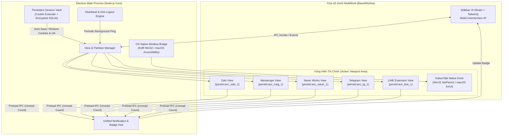
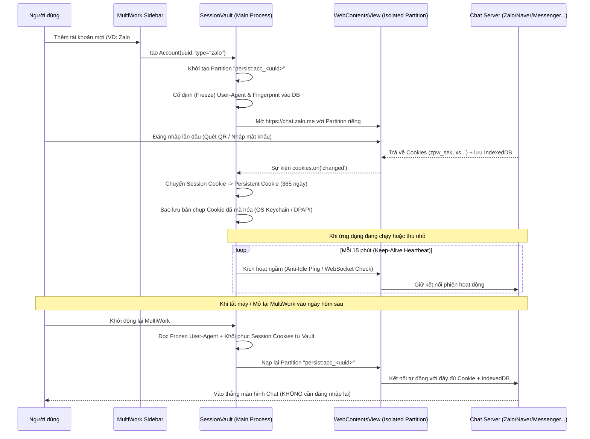

# Kiến Trúc Hệ Thống & Thiết Kế Kỹ Thuật (System Architecture)

Tài liệu này mô tả kiến trúc chi tiết của **MultiWork**, bao gồm mô hình tiến trình (Process Model), cơ chế lưu trữ phiên vĩnh viễn (Session Vault), cấu trúc thư mục mã nguồn và giao thức giao tiếp IPC.

---

## 1. Sơ đồ Kiến trúc Tổng thể (High-Level Architecture)



---

## 2. Cơ chế Lưu trữ Phiên Vĩnh viễn (Persistent Session Vault Flow)



---

## 3. Cấu trúc Thư mục Dự án (Proposed Directory Structure)

```text
MultiWork/
├── docs/                               # Tài liệu kiến trúc & Kế hoạch nghiên cứu
│   ├── PLAN.md                         # Kế hoạch tổng thể (Master Plan)
│   ├── AI_WORK_ASSISTANT.md            # Thiết kế AI Dịch chỉ thị Sếp -> To-Do & Lịch trình
│   ├── CHAT_PLATFORMS_ANALYSIS.md      # Phân tích kỹ thuật từng nền tảng chat
│   └── ARCHITECTURE.md                 # Tài liệu kiến trúc hệ thống
├── src/
│   ├── main/                           # Electron Main Process (Node.js + TypeScript)
│   │   ├── index.ts                    # Entry point khởi tạo BaseWindow (Bố cục 3 cột)
│   │   ├── view-manager.ts             # Quản lý vòng đời các WebContentsView
│   │   ├── session-vault.ts            # Lưu trữ Cookie vĩnh viễn, cố định User-Agent
│   │   ├── keep-alive.ts               # Tiến trình chống hết hạn phiên (Anti-Idle)
│   │   ├── extension-loader.ts         # Bộ nạp Chrome Extension (dành cho LINE cá nhân)
│   │   ├── ai-assistant/               # Phân hệ AI Tự động Dịch + To-Do + Schedule
│   │   │   ├── message-interceptor.ts  # Nhận luồng tin nhắn có @tag / từ Sếp
│   │   │   ├── ai-translator-agent.ts  # Gọi LLM dịch thuật & bóc tách Task/Event JSON
│   │   │   └── scheduler-alarm.ts      # Quản lý nhắc hẹn & đồng bộ Google/Outlook Calendar
│   │   ├── native-dock/                # Module nhúng cửa sổ KakaoTalk cá nhân + đọc thông báo
│   │   │   ├── win32-docker.ts         # Koffi/Win32 SetParent + Toast Notification Listener
│   │   │   └── macos-docker.ts         # AXUIElement Window Coordinator + Reader trên macOS
│   │   └── ipc-handlers.ts             # Xử lý giao tiếp IPC giữa UI và Main
│   ├── preload/                        # Preload Scripts
│   │   ├── sidebar-preload.ts          # Cầu nối API cho giao diện quản lý chính
│   │   └── recipes/                    # Script bắt Notification, @mention & Unread Badge
│   │       ├── base-interceptor.ts     # Hook window.Notification & ServiceWorker chung
│   │       ├── zalo.ts
│   │       ├── messenger.ts
│   │       ├── naver-works.ts
│   │       ├── telegram.ts
│   │       └── line.ts
│   ├── renderer/                       # Giao diện Sidebar Trái & AI Assistant Phải (React)
│   │   ├── App.tsx
│   │   ├── components/
│   │   │   ├── Sidebar.tsx             # Cột Trái: Danh sách các tài khoản chat cá nhân
│   │   │   ├── RightAssistantPanel.tsx # Cột Phải: Bảng AI Dịch chỉ thị Sếp, To-Do & Lịch
│   │   │   ├── BossDirectiveFeed.tsx   # Luồng tin nhắn Sếp / @tag đã dịch tự động
│   │   │   ├── TodoBoard.tsx           # Quản lý danh sách việc cần làm (To-Do List)
│   │   │   ├── ScheduleCalendar.tsx    # Lịch biểu, Event & cài đặt chuông nhắc việc
│   │   │   └── BossWatchlistModal.tsx  # Cài đặt danh sách Sếp & từ khóa @mention
│   │   └── store/
│   │       ├── useAccountsStore.ts     # Quản lý trạng thái danh sách tài khoản
│   │       └── useAssistantStore.ts    # Quản lý trạng thái To-Do, Events, Bản dịch
│   └── shared/                         # Kiểu dữ liệu dùng chung (TypeScript Interfaces)
│       └── types.ts
├── resources/                          # Icons, Extension CRX của LINE, Assets
├── electron-builder.yml                # Cấu hình đóng gói bộ cài Windows (.exe) & macOS (.dmg)
├── package.json
└── tsconfig.json
```

---

## 4. Thiết kế Schema Quản lý Tài khoản, To-Do & Lịch trình (`shared/types.ts`)

```typescript
export type ServiceType =
  | 'zalo'
  | 'messenger'
  | 'naver-works'
  | 'telegram'
  | 'line-personal'
  | 'kakaotalk-personal'
  | 'whatsapp'
  | 'slack'
  | 'discord'
  | 'teams'
  | 'custom-web';

export interface AccountInstance {
  id: string;                      // UUID duy nhất (VD: "acc_9f8a7b...")
  serviceType: ServiceType;        // Loại dịch vụ chat cá nhân
  displayName: string;             // Tên gợi nhớ (VD: "Zalo Cá nhân", "KakaoTalk Hàn")
  workspaceId: string;             // Thuộc nhóm Workspace nào
  partitionName: string;           // "persist:acc_9f8a7b..."
  frozenUserAgent: string;         // User-Agent cố định suốt vòng đời tài khoản
  unreadCount: number;             // Số tin nhắn chưa đọc hiện tại
  isMuted: boolean;                // Tắt âm thông báo của riêng tài khoản này
  keepAliveIntervalMinutes: number;// Chu kỳ ping giữ phiên (Mặc định: 15 phút)
}

export interface BossWatchRule {
  id: string;
  myMentionKeywords: string[];     // VD: ["@Son", "@Sơn", "손님", "Sơn ơi"]
  bossSenderNames: string[];       // VD: ["김부장님", "Director Kim", "Sếp Hùng", "Tanaka"]
  targetLanguage: string;          // Ngôn ngữ dịch đích (Mặc định: "vi")
  autoCreateTodo: boolean;         // Tự động thêm vào To-Do List khi phát hiện giao việc
  autoCreateEvent: boolean;        // Tự động đặt lịch khi phát hiện thời gian họp/hẹn
}

export interface TodoItem {
  id: string;
  title: string;                   // Tiêu đề công việc đã dịch sang tiếng Việt
  originalMessage: string;         // Tin nhắn gốc của Sếp (Hàn/Nhật/Anh...)
  translatedMessage: string;       // Bản dịch đầy đủ
  sourceAccountId: string;         // Thuộc tài khoản chat nào (để click nhảy tới ngay)
  sourcePlatform: ServiceType;     // 'kakaotalk-personal' | 'zalo' | 'naver-works' | 'line-personal'...
  chatRoomName: string;            // Tên nhóm chat
  senderName: string;              // Tên Sếp giao việc
  priority: 'URGENT' | 'HIGH' | 'MEDIUM' | 'LOW';
  dueAt?: string;                  // ISO Timestamp hạn chót (Deadline)
  completed: boolean;
  createdAt: string;
}

export interface ScheduleEvent {
  id: string;
  title: string;                   // Tên sự kiện / Cuộc họp
  startTime: string;               // Thời gian bắt đầu (ISO 8601)
  endTime?: string;                // Thời gian kết thúc
  reminderMinutesBefore: number;   // Nhắc trước X phút (VD: 15 phút)
  sourceTodoId?: string;           // Liên kết với đầu việc gốc
  sourceAccountId: string;         // Nhảy về nhóm chat gốc
  syncedToExternalCalendar: boolean;
}
```

---

## 5. Bảo mật & Quyền riêng tư (Security Design)

1. **Cô lập Ngữ cảnh (`contextIsolation: true`, `sandbox: true`)**:
   - Các trang web chat (Zalo, Messenger...) không thể truy cập vào Node.js API hay đọc dữ liệu của các tab khác.
2. **Mã hóa Cookie Snapshot bằng OS Keychain (`safeStorage`)**:
   - Mọi bản sao lưu token/cookie dùng để khôi phục phiên đều được mã hóa bằng **Windows DPAPI** (trên Windows) hoặc **macOS Keychain** (trên Mac). Nếu kẻ gian copy thư mục dữ liệu sang máy tính khác cũng không thể giải mã được.
3. **Master Password / Biometric Lock**:
   - Hỗ trợ khóa nhanh giao diện bằng phím tắt `Ctrl/Cmd + L` khi rời bàn làm việc.
