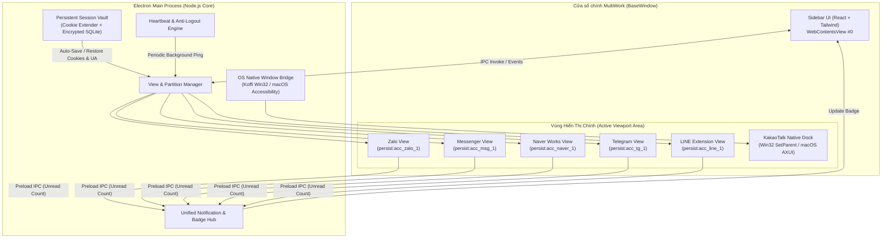
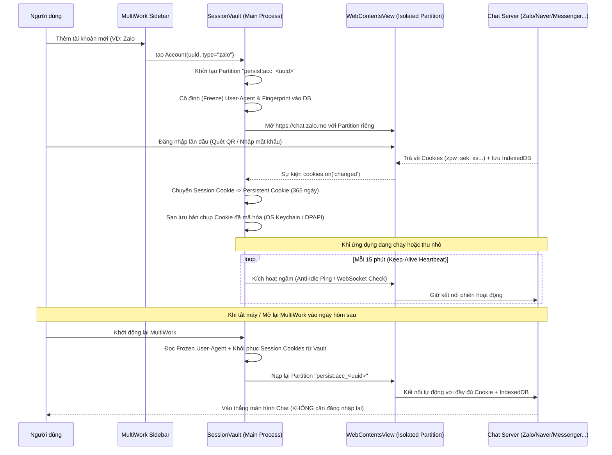

# Kiến Trúc Hệ Thống & Thiết Kế Kỹ Thuật (System Architecture)

Tài liệu này mô tả kiến trúc chi tiết của **MultiWork**, bao gồm mô hình tiến trình (Process Model), cơ chế lưu trữ phiên vĩnh viễn (Session Vault), cấu trúc thư mục mã nguồn và giao thức giao tiếp IPC.

---

## 1. Sơ đồ Kiến trúc Tổng thể (High-Level Architecture)



---

## 2. Cơ chế Lưu trữ Phiên Vĩnh viễn (Persistent Session Vault Flow)



---

## 3. Cấu trúc Thư mục Dự án (Proposed Directory Structure)

```text
MultiWork/
├── docs/                               # Tài liệu kiến trúc & Kế hoạch nghiên cứu
│   ├── PLAN.md                         # Kế hoạch tổng thể (Master Plan)
│   ├── CHAT_PLATFORMS_ANALYSIS.md      # Phân tích kỹ thuật từng nền tảng chat
│   └── ARCHITECTURE.md                 # Tài liệu kiến trúc hệ thống
├── src/
│   ├── main/                           # Electron Main Process (Node.js + TypeScript)
│   │   ├── index.ts                    # Entry point khởi tạo BaseWindow
│   │   ├── view-manager.ts             # Quản lý vòng đời các WebContentsView
│   │   ├── session-vault.ts            # Lưu trữ Cookie vĩnh viễn, cố định User-Agent
│   │   ├── keep-alive.ts               # Tiến trình chống hết hạn phiên (Anti-Idle)
│   │   ├── extension-loader.ts         # Bộ nạp Chrome Extension (dành cho LINE)
│   │   ├── native-dock/                # Module nhúng cửa sổ ứng dụng gốc (KakaoTalk)
│   │   │   ├── win32-docker.ts         # Sử dụng Koffi/Win32 SetParent trên Windows
│   │   │   └── macos-docker.ts         # Sử dụng AXUIElement coordinator trên macOS
│   │   └── ipc-handlers.ts             # Xử lý giao tiếp IPC giữa Sidebar và Main
│   ├── preload/                        # Preload Scripts
│   │   ├── sidebar-preload.ts          # Cầu nối API cho giao diện quản lý chính
│   │   └── recipes/                    # Script theo dõi tin nhắn chưa đọc từng dịch vụ
│   │       ├── zalo.ts
│   │       ├── messenger.ts
│   │       ├── naver-works.ts
│   │       ├── telegram.ts
│   │       └── line.ts
│   ├── renderer/                       # Giao diện Sidebar & Settings (React + Tailwind)
│   │   ├── App.tsx
│   │   ├── components/
│   │   │   ├── Sidebar.tsx             # Thanh danh sách các tài khoản chat
│   │   │   ├── AddServiceModal.tsx     # Hộp thoại thêm tài khoản (Zalo, Kakao, LINE...)
│   │   │   ├── WorkspaceSwitcher.tsx   # Chuyển đổi nhóm công việc
│   │   │   └── MasterLockScreen.tsx    # Màn hình khóa mật khẩu bảo vệ
│   │   └── store/
│   │       └── useAccountsStore.ts     # Quản lý trạng thái danh sách tài khoản
│   └── shared/                         # Kiểu dữ liệu dùng chung (TypeScript Interfaces)
│       └── types.ts
├── resources/                          # Icons, Extension CRX của LINE, Assets
├── electron-builder.yml                # Cấu hình đóng gói bộ cài Windows (.exe) & macOS (.dmg)
├── package.json
└── tsconfig.json
```

---

## 4. Thiết kế Schema Quản lý Tài khoản (`AccountConfig`)

```typescript
export type ServiceType =
  | 'zalo'
  | 'messenger'
  | 'naver-works'
  | 'telegram'
  | 'line-extension'
  | 'line-oa'
  | 'kakaotalk-native'
  | 'kakaotalk-channel'
  | 'whatsapp'
  | 'slack'
  | 'discord'
  | 'teams'
  | 'custom-web';

export interface AccountInstance {
  id: string;                      // UUID duy nhất (VD: "acc_9f8a7b...")
  serviceType: ServiceType;        // Loại dịch vụ chat
  displayName: string;             // Tên gợi nhớ (VD: "Zalo Công ty", "Zalo Cá nhân")
  workspaceId: string;             // Thuộc nhóm Workspace nào
  partitionName: string;           // "persist:acc_9f8a7b..."
  frozenUserAgent: string;         // User-Agent cố định suốt vòng đời tài khoản
  customUrl?: string;              // Dùng cho Naver Works domain riêng hoặc Custom Web
  unreadCount: number;             // Số tin nhắn chưa đọc hiện tại
  isMuted: boolean;                // Tắt âm thông báo của riêng tài khoản này
  hibernationEnabled: boolean;     // Cho phép ngủ đông tiết kiệm RAM hay không
  keepAliveIntervalMinutes: number;// Chu kỳ ping giữ phiên (Mặc định: 15 phút)
}
```

---

## 5. Bảo mật & Quyền riêng tư (Security Design)

1. **Cô lập Ngữ cảnh (`contextIsolation: true`, `sandbox: true`)**:
   - Các trang web chat (Zalo, Messenger...) không thể truy cập vào Node.js API hay đọc dữ liệu của các tab khác.
2. **Mã hóa Cookie Snapshot bằng OS Keychain (`safeStorage`)**:
   - Mọi bản sao lưu token/cookie dùng để khôi phục phiên đều được mã hóa bằng **Windows DPAPI** (trên Windows) hoặc **macOS Keychain** (trên Mac). Nếu kẻ gian copy thư mục dữ liệu sang máy tính khác cũng không thể giải mã được.
3. **Master Password / Biometric Lock**:
   - Hỗ trợ khóa nhanh giao diện bằng phím tắt `Ctrl/Cmd + L` khi rời bàn làm việc.
